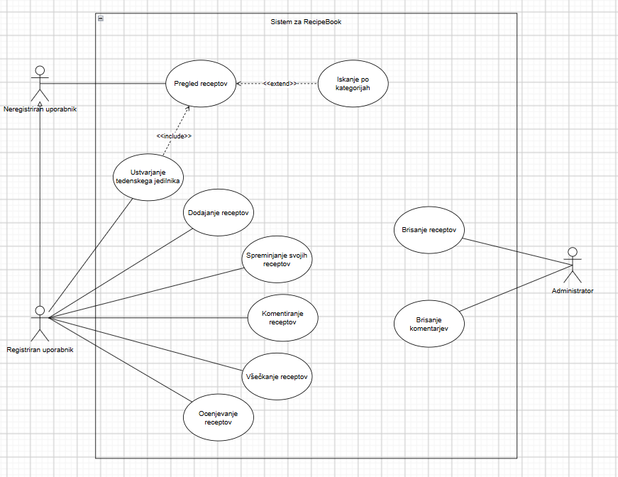

# RecipeBook
#Projekt: RecipeBook
#Člani ekipe: Rok Kokot Selinšek, Neža Kamenicki, Anej Filip

## 1. Vizija projekta

### Opis rešitve
Aplikacija RecipeBook je spletna rešitev, namenjena vsem, ki želijo enostavno organizirati, shranjevati in hitro dostopati do svojih najljubših kuharskih receptov na enem mestu. Glavni namen aplikacije je z digitalizacijo rešiti probleme pri organizaciji, iskanju in urejanju receptov, ki se pojavijo pri receptih shranjenih v fizični obliki.

### Ključne funkcionalnosti
- Dodajanje novih receptov: Uporabnik lahko preprosto vnese nov recept z nazivom, opisom in časom priprave.
- Pregledovanje receptov: Celovit vpogled v vse shranjene recepte v preglednem vmesniku.
- Urejanje obstoječih receptov: Možnost posodabljanja podatkov in popravljanja vsebine receptov.
- Brisanje receptov: Odstranitev neustreznih ali zastarelih receptov iz sistema.
- Iskanje po nazivu: Hitro pronicanje in filtriranje receptov glede na vpisani niz v nazivu jedi. 
- Razvrščanje po času priprave: Organizacija in sortiranje receptov glede na čas, potreben za njihovo pripravo.

### Obseg rešitve: Aplikacija v trenutnem obsegu pokriva osnovno in zanesljivo upravljanje zbirke receptov za uporabnika, podpira delovanje baze podatkov prek Dockerja ter omogoča komunikacijo med uporabniškim vmesnikom in zalednim strežnikom. 
Obseg rešitve pokriva:
- Arhitekturo in okolje: Vzpostavitev ločenega zaledja in frontenda, pri čemer je podatkovna baza varno izolirana in zagnana prek containerjev.
-Upravljanje podatkov (CRUD operacije): Polno podporo za ustvarjanje novih receptov, njihov pregled, posodabljanje obstoječih vnosov in brisanje podatkov.
-Napredno obdelavo podatkov: Implementacijo funkcij za iskanje receptov po nazivu ter sortiranje in filtriranje glede na čas priprave, kar uporabniku omogoča hitro prilagajanje seznama.
-Tehnično dokumentiranje: Vključitev avtomatizirane Swagger dokumentacije za pregledovanje REST API končnih točk

### Morebitne omejitve: 
- Aplikacija deluje le kot spletna rešitev in nima mobilne aplikacije.
- Jezikovna in regijska omejitev: Uporabniški vmesnik in zbirka podatkov sta prilagojena izključno za vnos v slovenskem jeziku, brez podpore za večjezičnost ali lokalizacijo.
- Brez zunanjih kulinaričnih integracij: Aplikacija deluje kot samostojen sistem in nima povezav z zunanjimi spletnimi viri, bazami živil za izračun hranilnih vrednosti (kalorij) ali orodji za samodejni uvoz receptov s spleta.

### Besednjak
- Recept: Osnovna domenska entiteta, ki predstavlja zapis o jedi ter vsebuje njen naziv, podroben opis priprave in čas, potreben za njeno izvedbo.
- Naziv recepta: Jedinstveno besedilno ime jedi, ki služi kot primarni identifikator pri iskanju in prepoznavanju recepta.
- Čas priprave: Število minut, ki so potrebne za celotno pripravo in kuhanje/peko posamezne jedi.
- Zbirka receptov: Celoten nabor vseh v bazi shranjenih receptov, ki so uporabniku na voljo za pregled, filtriranje in urejanje.


## 2. Uporabljene tehnologije

### Frontend
- React 19.3.1
- JavaScript ES6+
- HTML HTML5
- CSS CSS3
- Axios 1.20.0
- Node.js 25.9.0
- npm 11.12.1

### Backend
- Java 25
- Spring Boot 4.1.1
- Spring Data JPA 4.1.1
- Maven 3.10.0
- Hibernate 7.4.5.Final
- PostgreSQL 18.3
- Springdoc OpenAPI 3.1.0

### Orodja
- Docker Desktop / Docker Engine 29.2.1
- Docker Compose 5.1.0
- Git 2.54.0
- GitHub spletna platforma
- Swagger UI 5.32.11


## 3. Struktura projekta

Projekt je razdeljen na dva glavna dela: frontend in backend.

```text
RecipeBook/
│
├── backend/
│   ├── src/
│   │   ├── main/
│   │   │   ├── java/
│   │   │   │   └── com/example/backend/backend/
│   │   │   │       ├── BackendApplication.java
│   │   │   │       ├── Recept.java
│   │   │   │       ├── ReceptRepository.java
│   │   │   │       └── ReceptRestEndpoint.java
│   │   │   └── resources/
│   │   │       └── application.properties
│   │   └── test/
│   └── pom.xml
│
├── frontend/
│   ├── public/
│   ├── src/
│   │   ├── services/
│   │   │   ├── api.js
│   │   │   └── receptService.js
│   │   ├── App.js
│   │   ├── App.css
│   │   └── index.js
│   ├── package.json
│   └── package-lock.json
│
├── .gitignore
└── README.md
```

### Opis map in datotek

**Frontend:**
- `public/` vsebuje javne datoteke in slike.
- `src/` vsebuje izvorno kodo React aplikacije.
- `services/` vsebuje datoteke za komunikacijo z backendom.
- `App.js` vsebuje glavno logiko aplikacije.
- `App.css` vsebuje oblikovanje spletne strani.
- `package.json` vsebuje odvisnosti in ukaze za zagon.

**Backend:**
- `src/main/java/` vsebuje Java izvorno kodo.
- `Recept.java` predstavlja entiteto recepta.
- `ReceptRepository.java` omogoča dostop do podatkovne baze.
- `ReceptRestEndpoint.java` vsebuje REST API operacije.
- `application.properties` vsebuje konfiguracijo aplikacije in podatkovne baze.
- `pom.xml` vsebuje odvisnosti in nastavitve Maven projekta.

**Glavne datoteke projekta:**

- docker-compose.yml vsebuje konfiguracijo za zagon PostgreSQL podatkovne baze v Dockerju.
- .env vsebuje lokalne okoljske spremenljivke in geslo za podatkovno bazo. Datoteka ni vključena v Git repozitorij.
- .gitignore določa datoteke in mape, ki se ne nalagajo na GitHub.

## 4. Navodila za namestitev in zagon

### 4.1 Predpogoji

Za zagon projekta potrebujemo:

- Java JDK 25.
- Node.js 25.9.0 in npm 11.12.1.
- Docker Desktop z Docker Compose.
- Git.

Za razvoj priporočamo IntelliJ IDEA za backend in Visual Studio Code za frontend.

### 4.2 Prenos projekta

Projekt prenesemo z GitHub repozitorija:

```bash
git clone https://github.com/rokkk56/RecipeBook.git
cd RecipeBook
```

### 4.3 Nastavitev okoljske datoteke

V glavni mapi projekta ustvarimo datoteko `.env`.

V datoteko dodamo:

```env
POSTGRES_PASSWORD=izberi_svoje_geslo
```

Namesto `izberi_svoje_geslo` uporabimo lastno geslo.

Datoteke `.env` ne nalagamo na GitHub, saj vsebuje občutljive podatke.

### 4.4 Zagon podatkovne baze z Dockerjem

Najprej zaženemo Docker Desktop.

V terminalu, znotraj glavne mape projekta, izvedemo:

```bash
docker compose up -d
```

Docker Compose samodejno ustvari PostgreSQL vsebnik in podatkovno bazo.

Nastavitve podatkovne baze:

| Nastavitev | Vrednost |
|---|---|
| Ime vsebnika | recipebook-postgres |
| Docker image | postgres:18.3 |
| Ime baze | recipebook |
| Uporabniško ime | postgres |
| Geslo | Vrednost iz datoteke `.env` |
| Vrata računalnika | 5434 |
| Vrata vsebnika | 5432 |
| Docker volume | recipebook-data |

Podatki se shranjujejo v ločen Docker volume `recipebook-data`, zato so ločeni od drugih lokalnih projektov.

Za preverjanje delovanja vsebnika uporabimo:

```bash
docker ps
```

Za ustavitev vsebnika uporabimo:

```bash
docker compose down
```

Ukaz `docker compose down` ne izbriše podatkov v Docker volume.

### 4.5 Zagon backenda

1. Odpremo mapo `backend` v IntelliJ IDEA.
2. Počakamo, da Maven naloži vse potrebne odvisnosti.
3. V konfiguraciji zagona `BackendApplication` nastavimo okoljsko spremenljivko:

```text
POSTGRES_PASSWORD=geslo_iz_datoteke_env
```

Uporabimo isto geslo, kot smo ga nastavili v glavni datoteki `.env`.

4. Zaženemo datoteko `BackendApplication.java`.

Backend je dostopen na naslovu:

[http://localhost:8080](http://localhost:8080)

Swagger dokumentacija je dostopna na:

[http://localhost:8080/swagger-ui/index.html](http://localhost:8080/swagger-ui/index.html)

### 4.6 Zagon frontenda

1. Odpremo mapo `frontend` v Visual Studio Code.
2. Preverimo, ali datoteka `frontend/.env` vsebuje naslov backenda:

```env
REACT_APP_BASE_URL=http://localhost:8080/api
```

3. Odpremo terminal.
4. Izvedemo ukaz:

```bash
npm install
```

5. Zaženemo aplikacijo:

```bash
npm start
```

Frontend je dostopen na naslovu:

[http://localhost:3000](http://localhost:3000)

### 4.7 Vrstni red zagona

Za pravilno delovanje aplikacije upoštevamo naslednji vrstni red:

1. Zaženemo Docker Desktop.
2. Zaženemo PostgreSQL z ukazom `docker compose up -d`.
3. Zaženemo backend.
4. Zaženemo frontend.

## 5. Navodila za razvijalce

Projekt je shranjen na GitHubu:

https://github.com/rokkk56/RecipeBook

Za delo na projektu razvijalec najprej prenese repozitorij:
git clone https://github.com/rokkk56/RecipeBook.git

Nato odpre projekt v ustreznem razvojnem okolju.

Pri skupinskem razvoju uporabljamo naslednji način dela:

Pred začetkom dela pridobimo najnovejšo različico kode z ukazom git pull.

Za novo funkcionalnost ustvarimo svojo vejo, na primer feature/iskanje-receptov.

Spremembe v kodi preverimo in preizkusimo.

Spremenjene datoteke dodamo z ukazom git add .

Spremembe shranimo z ukazom git commit -m "Opis spremembe".

Svojo vejo pošljemo na GitHub z ukazom git push.

Po potrebi ustvarimo Pull Request za pregled in združitev sprememb v glavno vejo main.

## 6. Standardi kodiranja

### Java (Backend)
- Imena razredov zapisujemo v obliki PascalCase, npr. `Recept`, `ReceptRepository` in `ReceptRestEndpoint`.
- Imena metod in spremenljivk zapisujemo v obliki camelCase, npr. `pridobiVseRecepte`.
- Imena konstant zapisujemo z velikimi črkami in podčrtaji.
- Vsak razred ima jasno določeno odgovornost. Entiteta predstavlja podatke, repository skrbi za dostop do baze, REST endpoint pa obravnava HTTP zahteve.
- Uporabljamo ustrezne HTTP metode: GET za pridobivanje, POST za dodajanje, PUT za posodabljanje in DELETE za brisanje.

### JavaScript in React (Frontend)
- Imena React komponent zapisujemo v obliki PascalCase, npr. `App`.
- Imena spremenljivk in funkcij zapisujemo v obliki camelCase, npr. `filtriraniRecepti`, `dodajRecept` in `izbrisiRecept`.
- React komponente ustvarjamo s funkcijami.
- Za upravljanje stanja uporabljamo React Hook `useState`.
- Klice na REST API izvajamo prek ločenih servisnih datotek v mapi `services`.
- Za komunikacijo z backendom uporabljamo knjižnico Axios.

### CSS
- Imena CSS razredov zapisujemo z malimi črkami in vezaji, npr. `recept-kartica` in `iskanje-receptov`.
- Za posamezne elemente uporabljamo ločene CSS selektorje.
- Oblikovanje hranimo v datotekah CSS in ga ne mešamo z logiko aplikacije.

### Git
- Glavna veja projekta je `main`.
- Commit sporočila naj bodo kratka in opisujejo opravljeno spremembo.
- Pred nalaganjem sprememb na GitHub preverimo delovanje aplikacije.
- V repozitorij ne dodajamo map `node_modules`, `target` in datotek `.env`.

## 7. DPU diagram
